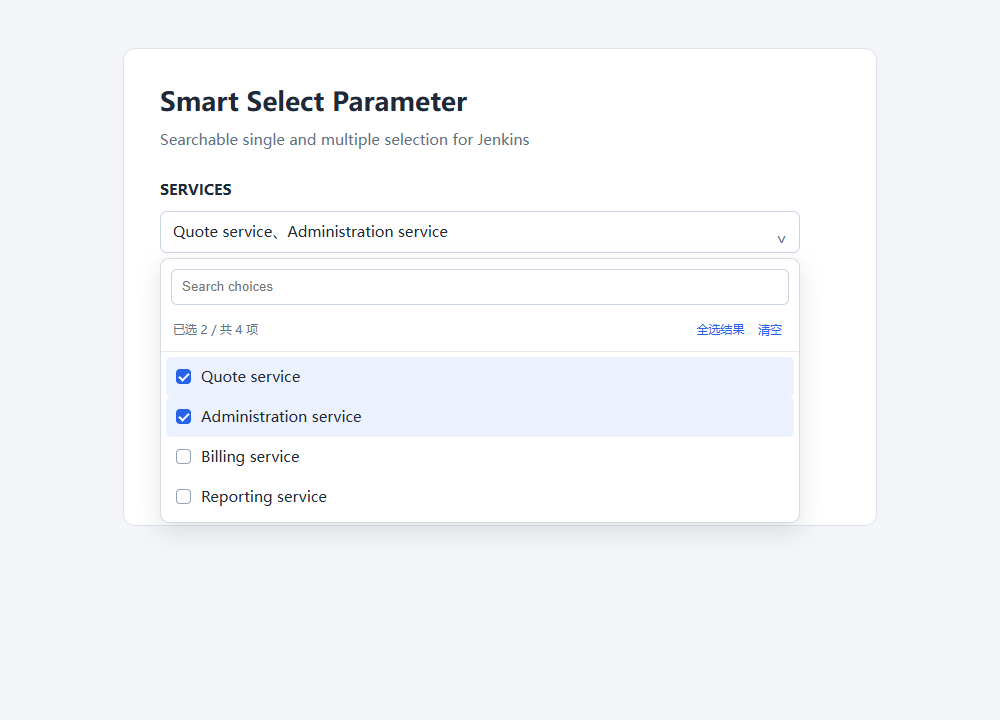

# Smart Select Parameter

Compact searchable single- and multi-select Jenkins build parameters with optional REST data sources and validated cascading selections. No additional runtime plugin or third-party JavaScript library is required.

**Unreleased publication candidate: 1.0.2-SNAPSHOT.** This source repository is public with the maintainer's authorization. Official Jenkins hosting and the first update-center release remain pending; a public source repository is not itself an approved plugin release.

[中文说明](README.zh-CN.md) · [Contributing](CONTRIBUTING.md) · [Security](SECURITY.md) · [Publication checklist](publishing/README.md)

## Features

- Single/multiple selection; search by label or value; filtered select-all and clear.
- Separate display labels and stable values. Multiple selections produce a comma-separated string.
- Administrator-approved REST GET sources, encrypted optional bearer token, JSON array paths, bounded responses/timeouts and caching.
- Cascading choices revalidated on the server for actual form/API/CLI parent values, independent of parameter order, with cycle detection.
- Up to 2,000 choices; at most 100 option buttons attached per page. Select-all includes matching choices on other pages.
- Keyboard navigation, named controls, list position information, stale-response isolation, loading/error states and retry.

The current widget and several configuration/error messages are in Simplified Chinese. Complete English UI localization remains a follow-up item. This documentation does not claim an accessibility or security certification.



## Requirements and installation

Jenkins **2.547** or newer, with Java **21** or a newer Java version supported by that controller. Development uses Maven 3.9+, Java 21, Node.js 24 and Python 3.12. Pipeline components are test dependencies only; the controller running a Pipeline example needs Pipeline installed.

Run `mvn -B -ntp clean verify`, then install `target/smart-select-parameter.hpi` through **Manage Jenkins → Plugins → Advanced settings → Deploy Plugin**. Follow Jenkins' activation/restart instructions. Update-center availability is pending hosting and a first official release.

Add **Smart Select Parameter** to a parameterized job. Existing plain choices configurations remain supported. Back up the previous plugin and job configurations before upgrading; a downgrade may also need old configurations restored.

## Static choices and labels

Use one value per line in ordinary choices, or use the label/value JSON field:

```json
[{"value":"price","label":"Quote service"},{"value":"admin","label":"Administration service"}]
```

Users see the label; builds receive `price` or `price,admin`. Search matches both.

```groovy
pipeline {
    agent none
    parameters {
        smartSelect(name: 'SERVICES', mode: 'MULTI', searchable: true,
            options: [[value: 'price', label: 'Quote service'],
                      [value: 'admin', label: 'Administration service']],
            defaultValues: ['price'])
        smartSelect(name: 'ENV', mode: 'SINGLE', choices: ['dev', 'release'])
    }
    stages {
        stage('Read selection') {
            steps { echo "Environment=${params.ENV}; Services=${params.SERVICES}" }
        }
    }
}
```

The integration test executes [examples/Jenkinsfile](examples/Jenkinsfile). A [REST example](examples/Jenkinsfile-rest) is also included.

## REST options

An administrator first approves the origin in **Manage Jenkins → System → Smart Select REST 数据源授权**, one origin per line, such as `https://services.example.com`. Authorization includes all paths on that scheme/host/effective port. Approve only trusted services. No origin is approved by default.

Configure the full REST URL. Responses must be JSON: a root array of strings or label/value objects, or an object containing such an array:

```json
{"data":{"items":[{"value":"price","label":"Quote service"}]}}
```

For this object use `restItemsPath: 'data.items'`; leave it empty for a root array. Dot-separated object keys are supported; JSONPath expressions are not evaluated. Values must be strings.

REST overrides nonempty `options`, which overrides ordinary `choices`. A failed fetch never falls back to static choices. Unexpired cached data may still be used; expired data is not a fallback. Default cache lifetime is 30 seconds, configurable from 0 through 300. One recent context is cached per parameter. Manual reload bypasses that parameter's cache.

HTTP/HTTPS are supported; HTTP is plaintext, so prefer HTTPS for sensitive sources. Embedded URL credentials, fragments and redirects are rejected. Jenkins proxy settings and normal TLS validation apply. Connect/read timeouts are 3 seconds each, with an additional 5-second body deadline and 1 MiB body limit. The browser stops waiting after 10 seconds.

An optional bearer token is stored with Jenkins Secret. It is not returned by the options endpoint or rendered in the build-selection page. Never commit a real token to a Jenkinsfile. Re-declaring the parameter in a Pipeline can overwrite UI-managed settings, including its token; administrators must manage these consistently. See [security boundaries](SECURITY.md).

## Cascading choices

```groovy
smartSelect(name: 'ENV', mode: 'SINGLE', choices: ['dev', 'release'])
smartSelect(name: 'SERVICES', mode: 'MULTI', dependsOn: 'ENV',
    restUrl: 'https://services.example.com/options?env=${ENV}',
    restItemsPath: 'data.items', cacheSeconds: 30)
```

Keep the URL single-quoted so Groovy does not expand the placeholder. Replace the example origin and authorize your service before use.

- Up to eight comma-separated names in `dependsOn`; cascading requires a REST source.
- Every declared dependency needs a query placeholder. Host/path and undeclared placeholders are rejected. Values are URL-encoded.
- Recursive dependencies have cycle detection and a 16-level limit. Smart Select and supported Jenkins simple parameters can be parents; sensitive/complex parameter objects are rejected.
- Changing a parent clears old selections. Loading, missing parents and failures pause browser submission.
- The controller validates actual submitted parents again. A value from another environment cannot be submitted under the current parent.
- The first browser load can apply valid defaults; subsequent parent changes require re-selection. API requests omitting the child calculate defaults from the submitted parent context.
- Context-free dependent defaults are empty, including the first noninteractive Pipeline run. Register parameters first, then submit values via build page/API/CLI. CLI users should explicitly pass both parent and child values.

## Configuration

| Property | Default | Meaning |
| --- | --- | --- |
| name | required | Parameter name |
| mode | MULTI | SINGLE or MULTI |
| searchable | true | Show search |
| choices | empty | String list or newline-separated values |
| options | empty | Label/value list or JSON array text |
| defaultValues | empty | Values, not labels; list or comma-separated text |
| restUrl | empty | Full REST URL |
| restItemsPath | empty | Dot-separated array path |
| restToken | empty | Optional encrypted bearer token |
| cacheSeconds | 30 | 0–300 seconds |
| dependsOn | empty | Comma-separated parent names |

At most 2,000 choices. Each label/value is at most 256 characters. Values cannot contain commas or line breaks; labels may contain commas, but no line breaks. Identical entries are deduplicated; one value with conflicting labels is rejected. Independent single-select defaults to its first choice; multi-select defaults to empty.

## Keyboard and non-UI callers

Enter/Space opens the trigger; Down/Up opens and focuses the first/last item. Search arrows enter results; Enter chooses the first match without submitting the build. Option arrows move; Home/End cross pages to the first/last result. Escape closes and restores focus. Tab closes without trapping focus. Navigation also works with search disabled.

```bash
curl -u 'USER:API_TOKEN' -X POST \
  'https://jenkins.example.com/job/example/buildWithParameters' \
  --data-urlencode 'ENV=release' \
  --data-urlencode 'SERVICES=price,admin'

java -jar jenkins-cli.jar -s https://jenkins.example.com/ build example \
  -p ENV=release -p SERVICES=price,admin -s
```

Use values allowed by the selected environment. Jenkins permissions/CSRF rules still apply. Reload requires the job's Build permission; origin authorization requires Administer.

## Development

```bash
mvn -B -ntp clean verify
node --check src/main/resources/io/jenkins/plugins/smartselect/smart-select.js
node src/test/offline/widget-smoke.cjs
python scripts/publication_check.py
python -m unittest discover -s tests -v
```

[Testing notes](docs/testing.md) · [Changelog](CHANGELOG.md). Configured remote CI does not mean those jobs have run before the source is public.

## License

[MIT](LICENSE). The owner must confirm copyright and permission to publish before making this source public.
